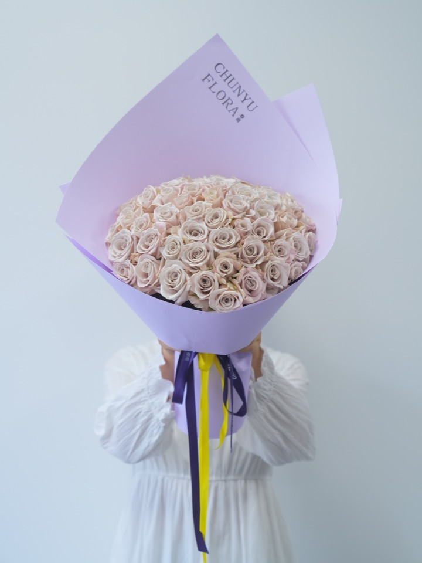

# 芙洛拉 Flora 移动端设计系统

微信小程序首发。后续 iOS、安卓、抖音和小红书版本沿用本手册。它规定同一种内容怎么展示、同一个动作怎么表达。各入口的首屏构图、信息流列数和页面布局留给后续设计。

**怎么使用**　设计评审直接读这份手册。下载仓库后打开同目录的「样本.html」，可以离线切换主题与字号、试选花色。交给设计工具时提供本手册及 [tokens.json](tokens.json)。其中颜色按用途命名，尺寸采用逻辑单位，字号可以跟随用户设置缩放。

## 品牌和中文

芙洛拉连接喜欢花的人和收花地附近的精品花店。一个人可以晒今天阳台上开的花，也可以只带着「想要粉白色，小一点，送朋友」来找花。花店用自己的作品和当日花材回应，说明可以怎么做、多少钱，再与顾客商量。

像懂花的朋友一样说话。先写顾客能做的事，再补一句必要的解释。顾客端使用简体中文、中文标点、自然字距。品牌首次出现写「芙洛拉 Flora」，空间紧张时用「芙洛拉」。

| 使用场景 | 可直接采用的表达 |
| --- | --- |
| 表达喜好 | 想找什么颜色的花？ |
| 询问花店 | 问问这家花店 |
| 参考价格 | 作品参考价 ¥268。当天花材和报价请与花店确认。 |
| 未提供价格 | 联系花店询价 |
| 附近暂无结果 | 收花地附近还没找到花店。试试换个区域。 |
| 发送失败 | 没发出去，你写的需求还在。再试一次。 |
| 分享作品 | 分享花店作品 |

## 四个入口

顺序固定为 **逛花、选花束、找花店、我的**。逛花侧重日常实拍和作者，选花束侧重配色、大小、用途和参考价，找花店围绕收花地、店名与实拍作品，我的承接个人内容。图标始终配中文名，当前入口同时使用加粗文字和实心图标。平台分享、登录、定位授权由宿主承接。顾客拒绝定位后仍可手选收花地。

## 花束摄影

**逛花**允许桌面、阳台、手持等真实环境，尊重作者原图的比例和自然光。**选花束**比较同类款式时使用一致的展示框，优先完整呈现花头、外轮廓与包装底部；裁切会损失轮廓时改为完整适配并留白。小图显示不了的细节留给原图。不要用统一粉色滤镜修改花色。辨别大小优先用实测宽高，其次用手持比例；没有尺寸依据时标「大小待确认」。

花色筛选同时提供色样和中文色名，允许组合，如「粉色、白色」。花材色与包装色分别描述。选中色增加勾选和轮廓。照片缺失时显示「暂无实拍」，深色模式保留照片原色。文档照片仅作排版示例，价格和尺寸示例均不代表该摄影作品的实际商品信息。[照片来源，Andy Lee / Pexels](https://www.pexels.com/photo/elegant-bouquet-of-roses-with-lavender-wrapping-33886742/)

## 视觉基础

白底让花色成为第一眼关注点。柔粉用于主要动作和选中提示，深墨色用于文字和信息结构。卡片优先用留白与细边区分，仅在浮层使用轻阴影。暖粉灰细线用于装饰；需要看清边界的输入框使用单独的强边线。

| 用途 | 浅色 | 深色 |
|---|---|---|
| 底色 | #FFFFFF | #19131D |
| 分组底色 | #FFF3F6 | #302030 |
| 主要文字 | #1C0F1A | #FAF2F6 |
| 辅助文字 | #6F6570 | #D2C1CA |
| 主要操作 | #FFB0C8 | #FFB0C8 |
| 按钮文字 | #1C0F1A | #1C0F1A |
| 按下底色 | #F49CB4 | #F49CB4 |
| 装饰细线 | #E6DDE2 | #503D4A |
| 控件边线 | #806F7A | #AE99A6 |
| 成功 | #256341 | #8FE0AC |
| 待确认 | #805209 | #FFD58C |
| 失败 | #A32640 | #FFA4B7 |

中文字体跟随设备系统。中文标题自然字距，正文保持舒展。数字使用等宽数字特性；同组金额保持相同小数精度并对齐。参考价始终带说明。金额最醒目的字号仅用于专门的报价信息，花束卡片仍优先展示花。

| 中文角色 | 字号 / 行高 | 字重 | 样张 |
|---|---|---|---|
| 重点金额 | 36 / 44 | 700 | ¥268 |
| 大标题 | 28 / 38 | 700 | 周末逛花 |
| 分组标题 | 22 / 30 | 700 | 花店的新作品 |
| 报价金额 | 22 / 30 | 700 | ¥198–268 |
| 小标题 | 18 / 26 | 600 | 春日小花束 |
| 行内金额 | 16 / 24 | 600 | 参考价¥268 |
| 款式名称 | 16 / 24 | 600 | 浅粉玫瑰 |
| 正文 | 15 / 24 | 400 | 想要粉白色，小一点，送朋友。 |
| 按钮 | 16 / 24 | 700 | 问问这家花店 |
| 补充信息 | 13 / 20 | 400 | 粉色·小花束 |
| 短标签 | 12 / 18 | 600 | 已收藏 |
| 入口名称 | 12 / 18 | 600 | 选花束 |
| 图注 | 12 / 18 | 400 | 花店实拍 |

间距以 4 为基数，常用 4、8、12、16、20、24、32、40、56、72。常规左右留白 20，窄屏可收至 16。卡片圆角 20、内边距 20；输入框圆角 16，浮层上角 24。主按钮最小高度 56、圆角 28；搜索框最小高度 48。独立图标视觉大小 24、可点范围至少 44 × 44。以上均为逻辑尺寸，大字模式允许控件增高。

## 组件约定

| 组件 | 内容和动作 | 状态与边界 |
| --- | --- | --- |
| 主按钮 | 同一组操作突出一个动作，如「问问这家花店」。粉底墨字。 | 按下变深；发送时显示「正在发送…」并防重复提交；失败保留输入，恢复重试。 |
| 次按钮与图标 | 次按钮用描边，如「查看作品」；独立图标提供读屏名称，如「分享花店作品」。 | 键盘聚焦有清晰轮廓；收藏切换后读出「已收藏」。 |
| 搜索与输入 | 标签说明用途，如「收花地」，占位符可给例子。搜索支持清除。 | 清除后保留输入焦点；取消收起键盘。错误提示靠近输入框并说明补救动作。 |
| 花色筛选 | 花色名配色样；大小、用途用文字标签。 | 多选即时显示勾；清空恢复全部。无结果允许撤销筛选。 |
| 花束款式卡 | 实拍优先，附款名、花材配色、大小和参考价。咨询携带所选作品。 | 未知报价显示「联系花店询价」；读屏顺序为款名、特征、价格、动作。 |
| 生活记录 | 实拍配作者和一句观察，如「清早换了水，又开了两朵」。 | 作者可能是顾客或花店；日常记录无需价格。 |
| 花店作品 | 显示店名、服务区域与作品归属。分享后仍能辨认哪家店做的。 | 距离缺失时只写已知区域。营业状态和接单能力分别表达。 |
| 状态与反馈 | 等待、成功、失败都带文字。短反馈如「已收藏」。 | 关键错误持续到用户处理；短提示不能承载唯一的报价或错误说明。 |

轻按反馈约 160 毫秒，切换约 260 毫秒，浮层进入约 320 毫秒。开启减少动态效果后取消位移和缩放。给文字和图标留出独立的对比度，普通文字目标至少 4.5∶1。

## 跨端验收

1. 微信首发用苹果和安卓各一台看同一组样本。核对花瓣颜色、四个入口的顺序、按钮中文和参考价说明。
2. 顶部按实际状态栏、胶囊位置和可用宽度布局；底部留出安全区。键盘弹起后输入框和操作都能触及，返回后保留已选颜色。
3. 切换深浅主题、大字模式，在窄屏试一个长店名。名称可换行，按钮文字完整；颜色筛选即使不辨色也能操作。
4. 安卓及 iOS 独立应用、抖音与小红书接入时，复用相同的语义颜色、字号角色、圆角、图片处理和操作文案。逐端验证返回、分享、授权、键盘和系统控件。真机验证结果由上线团队按平台记录。

## 来源与版本说明

本版根据芙洛拉产品共识、此前 Claude 讨论和 OpenDesign 留存资料重建。借鉴 Klarna 的购物卡片层级、圆润按钮、金额排版和按压反馈。花束摄影、参考价与实际报价的区分、中文询价和多端适配按芙洛拉场景制定。旧版无法核对的细项以本版表格为准。更新规范、样本与参数时同次提交，GitHub 提交历史可回看旧版。[产品共识](../docs/product.md) · [Klarna 社区参考原文](https://github.com/Meliwat/awesome-ios-design-md/blob/5d3aeca239caef3ea4080034eb22ab87cc77fa24/design-md/finance/klarna/DESIGN.md)
