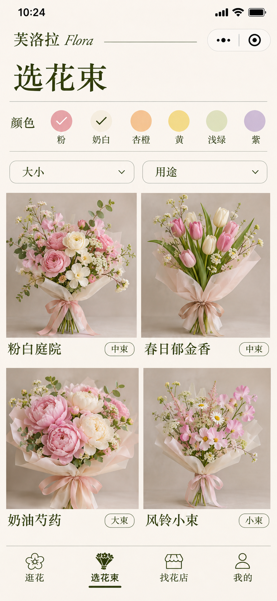
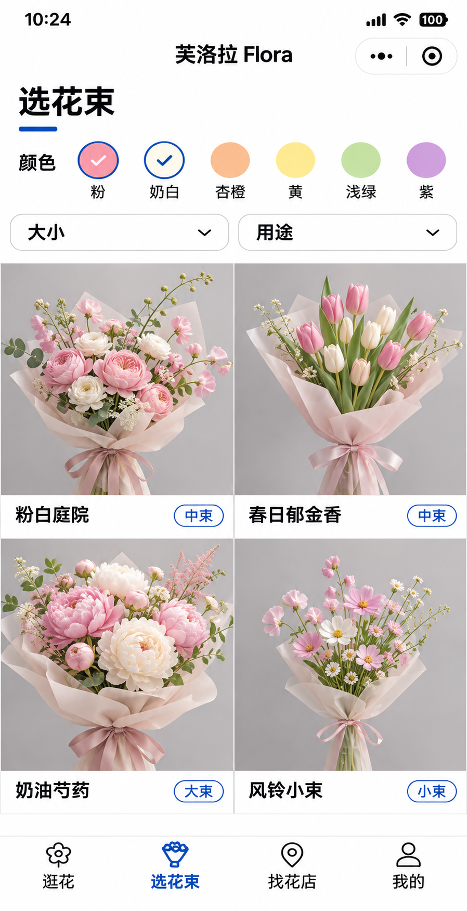
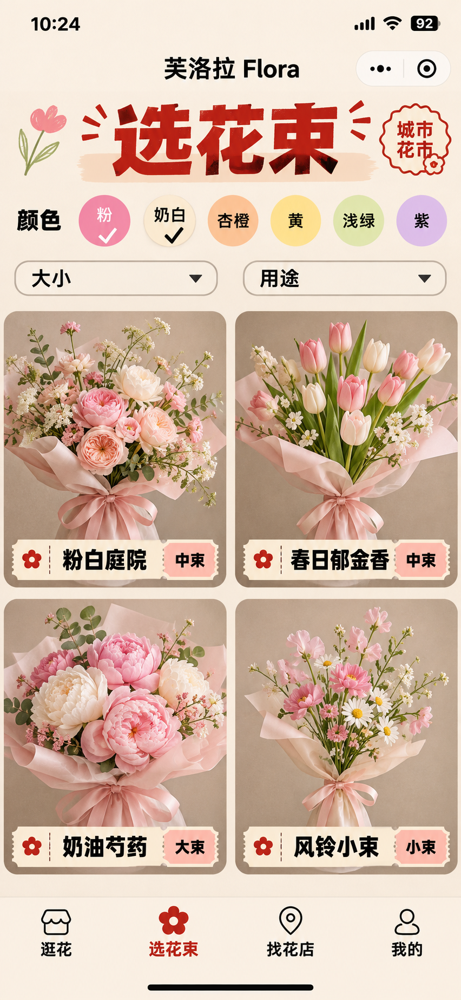

# 第一轮「选花束」探索稿 · 主理人已否定

主理人原话是「不是这样的 和我想象的完全不一样」。三张稿沿用了大标题、固定颜色圆点、大小与用途筛选、两列四张粉白花束图的构图。主理人否定了整体效果。究竟是构图、图片、密度、筛选方式还是其他原因，目前尚无逐项结论。

| 自然花艺杂志 | 清透现代色卡 | 城市花市 |
| --- | --- | --- |
|  |  |  |

这些图是生成的概念稿，图里的花束、款名和尺寸均为示例。看完后请回到主理人的参考图和真实描述，重新探索第一屏。
